<div align="center">

# NotchApp

**The MacBook notch, turned into a live, interactive hub.**

A black shape that melts into the notch, springs open into Liquid Glass on hover,
and keeps search, music, files, stats and your coding agents one flick of the pointer away.

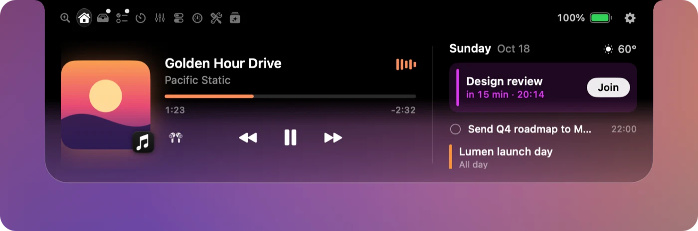

Native Swift · SwiftUI + AppKit + Core Animation · macOS 14.2+ · Apple silicon · no Xcode needed

</div>

---

## Search

The notch's best trick: **one bar that works out what you mean.** Describe a file the way you remember it,
ask a question, or just type a sum. Answers come from a **local model through Ollama**; nothing is sent to a cloud model.

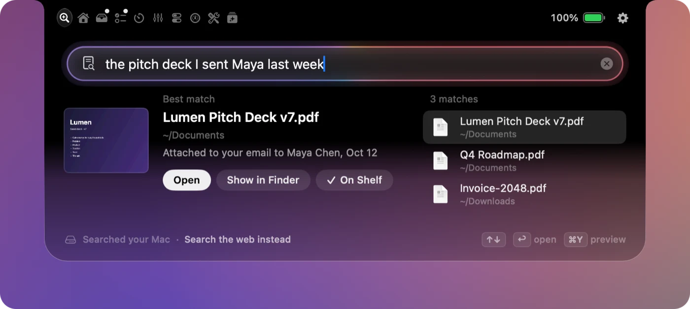

<p>
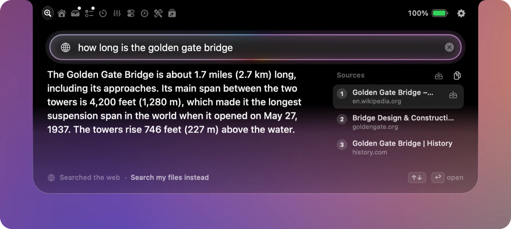
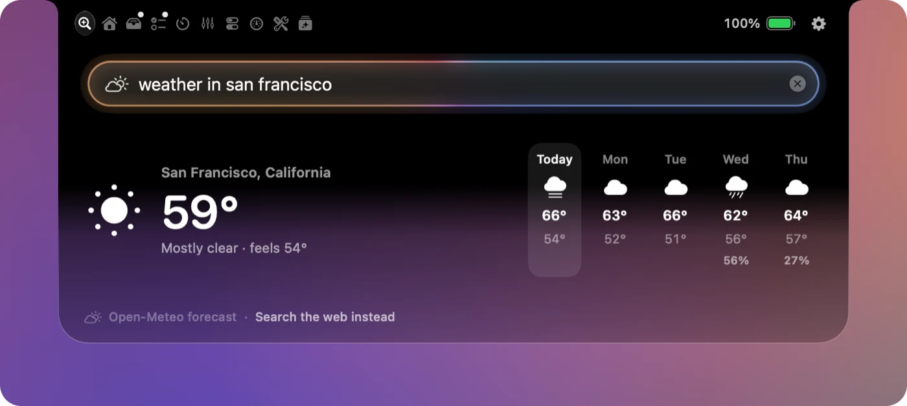
</p>

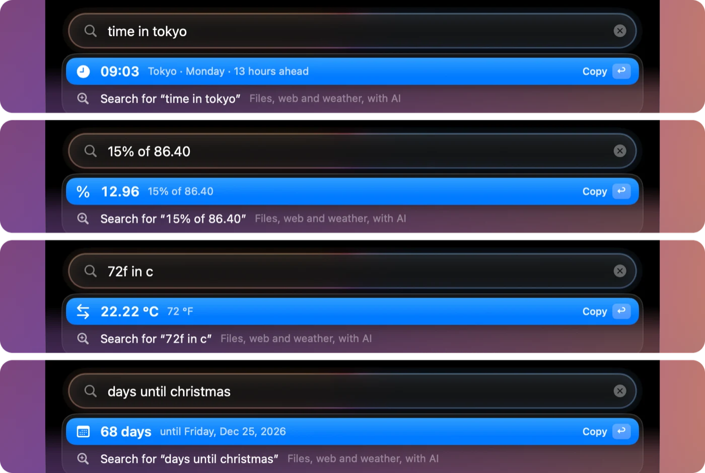

- **Files** from vague descriptions: who you sent it to, roughly when, what kind of file. Preview it, open it, or put it on the Shelf.
- **Web answers** written from the top pages, with numbered sources you can open or save.
- **Weather** for anywhere, with the week ahead.
- **Instant answers as you type**: maths, percentages, units, time zones, day counts. No model needed.
- **Commands**: `open spotify`, `timer 10m`, `speedtest`, `port 3000`, `uninstall slack`, `format json`, or paste a link to download a video.
- **Ask about this** (⌃⌥S) reads the window in front and lets you Explain, Summarize, Translate or Fix grammar, with follow-ups.

<br clear="right">

## Glances

Small live indicators beside the closed notch, up to five a side, in any mix: music, timer, next event,
weather, battery, CPU, GPU, memory, temperature, power, network, tasks, agents, world clock, Bluetooth batteries,
VPN and more. Every Glance has a **compact form**, and a side that runs out of room compacts its outer ones by itself.

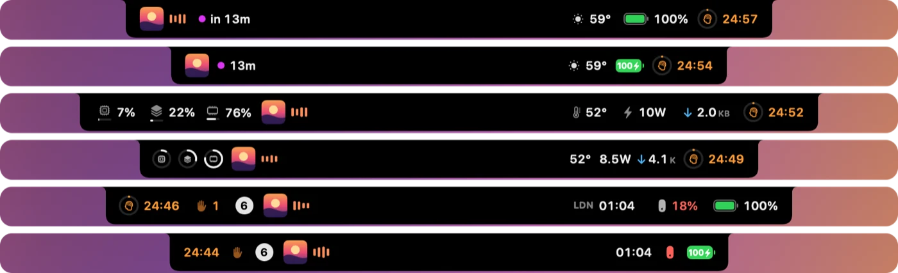

**Click** a Glance to act on it (play/pause, pause the timer, join the meeting, jump to an agent), **hold** it for details,
**right-click** for options.

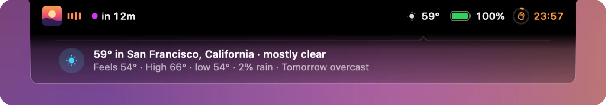

## Alerts, in three tiers

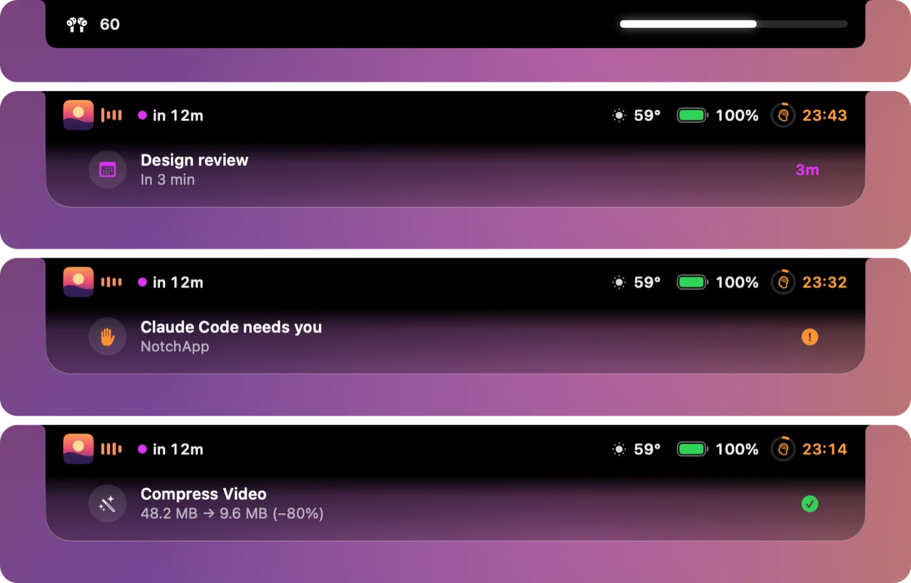

- **Flashes** sit in the wings: volume and brightness (instead of the system overlay), charging.
- **Banners** drop down under the notch without moving your Glances. They queue, pause under the pointer and wait while a full-screen app is in front.
- **Prompts** carry buttons (Join Zoom, Open, Snooze) and fold into a tab you can click later.

Meetings, coding agents that need you, finished downloads and conversions, a dev server coming up, going
offline, a VPN dropping, AirPods running low: each lands in the tier it deserves.

<br clear="right">

## Shelf

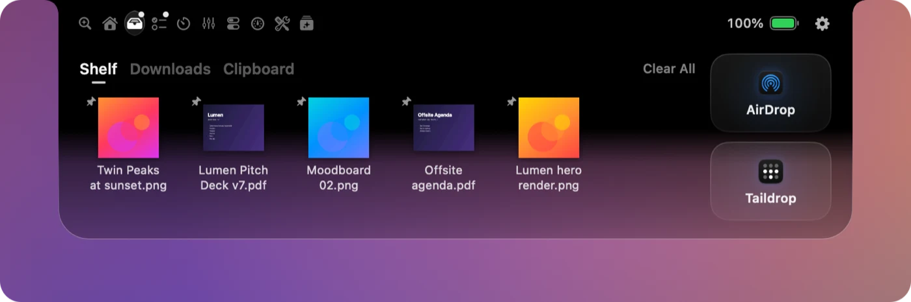

<p>
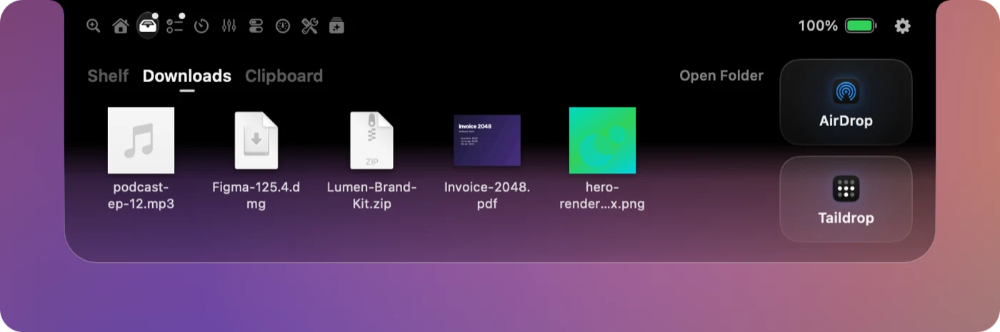
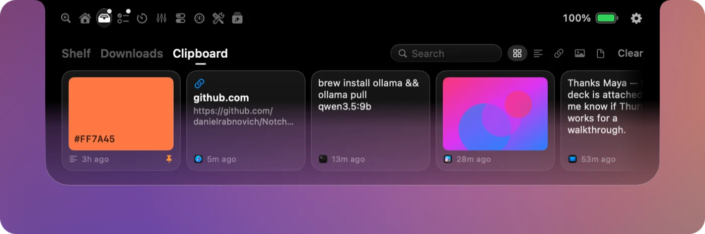
</p>

Drag files onto the notch and back out. **AirDrop** and **Taildrop** (your Tailscale devices) drop zones, screenshots
caught automatically, **recent Downloads**, and a **Clipboard history** that skips password managers. Drop files on the
Convert bin for MP4, GIF, compressed video, MP3/M4A or JPEG/PNG; video runs on the media engine.

## Tasks, Notes & Timer

<p>
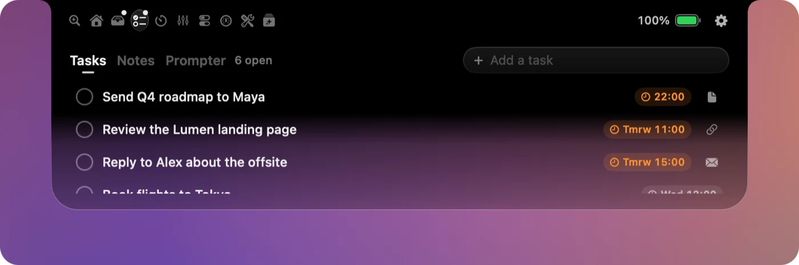
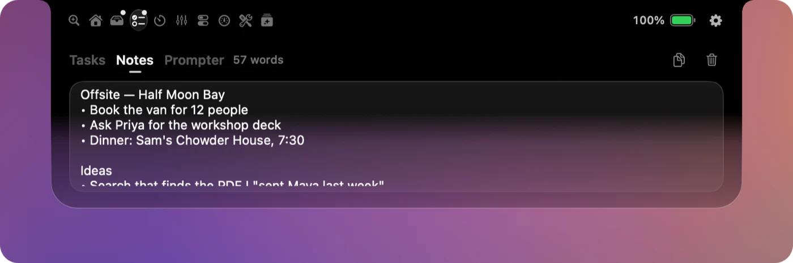
</p>

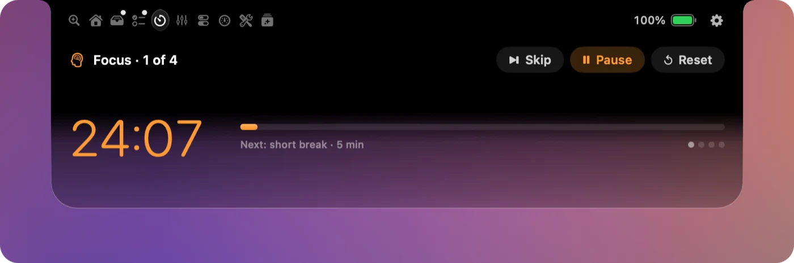

Drag text, links, emails or files onto the notch to make a task; type due dates the way you'd say them ("by Friday 3pm").
A scratchpad that saves itself, a teleprompter that rolls under the camera, and a countdown, Pomodoro and stopwatch
that keep ticking beside the notch.

## Controls & Mixer

Pick and order up to 12 Controls tiles from Wi-Fi, Keep Awake, Dark Mode, mic mute, Copy Text (OCR any region),
Ports, Speed Test, Cleaner, Night Shift, Flush DNS, Scan QR, Live Captions, Save Video and more. Homebrew and Sparkle
app updates sit under the sliders.

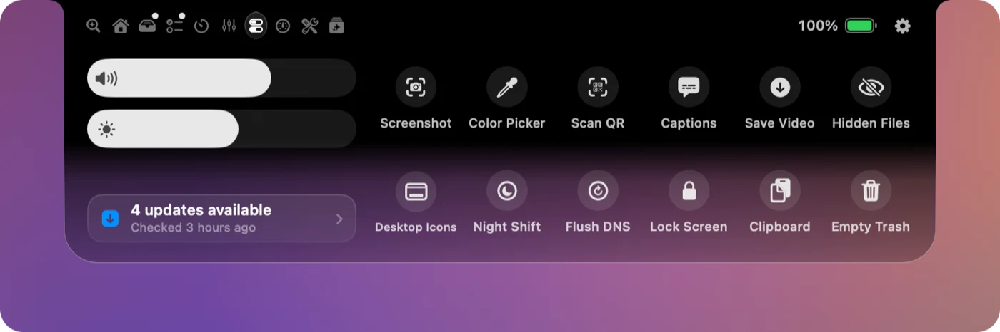

<p>
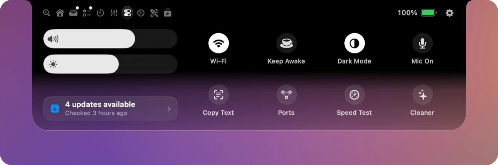
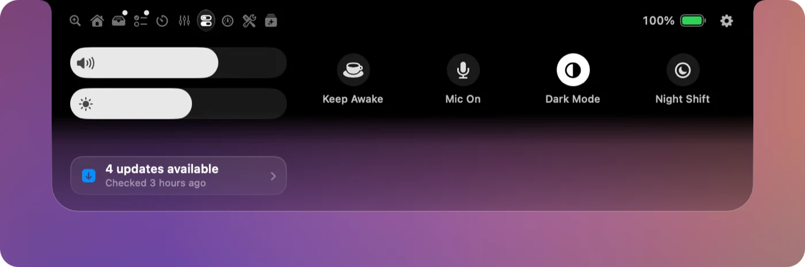
</p>

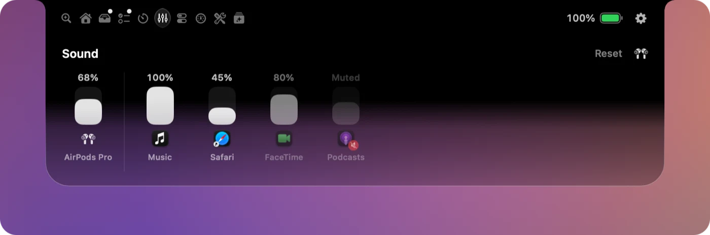

The **Mixer** sets each app's volume, or mutes it, through a Core Audio process tap. Apps left at 100% are untouched.

## Stats & Tools

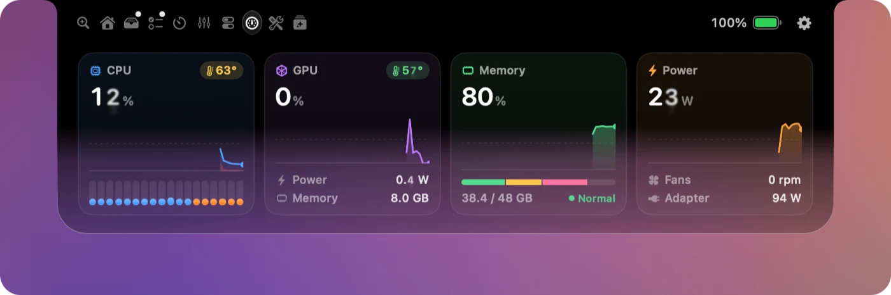

CPU (per-core bars, user/system graph), GPU, memory (app/wired/compressed, pressure) and power, with temperatures,
fan speed and battery time. Read straight from the SMC, IOReport and IOKit; no helper, no root.

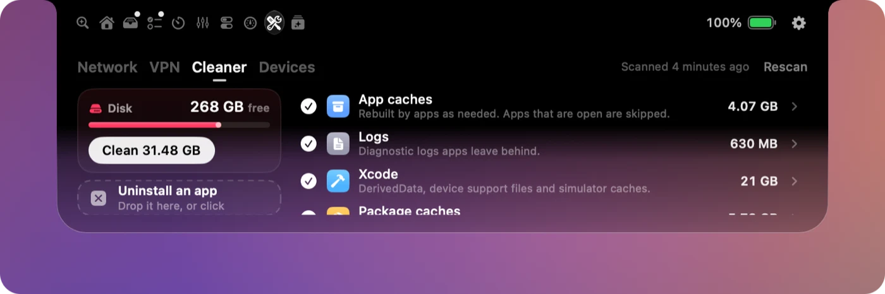

<p>
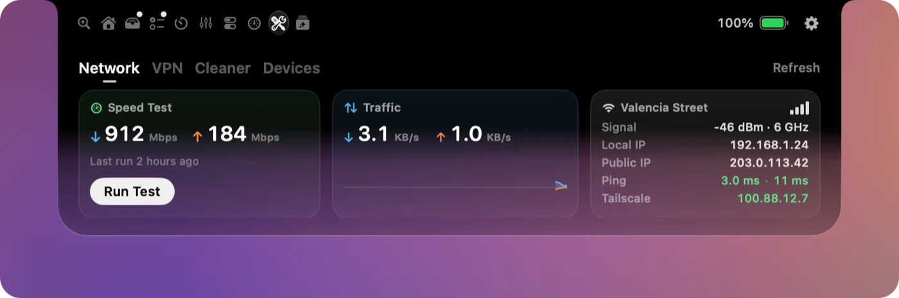
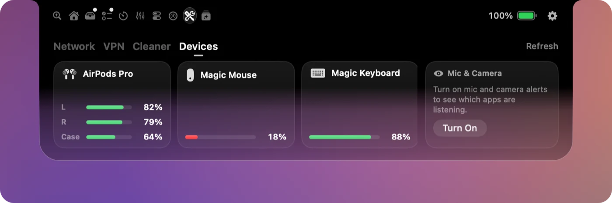
</p>

- **Cleaner**: caches, logs, Xcode and package-manager leftovers, old installers and big forgotten files, Time Machine snapshots, and an app uninstaller that finds leftovers in `~/Library`.
- **Network**: speed test with a live readout beside the notch, traffic, Wi-Fi signal and band, IPs, ping.
- **VPN**: every VPN on the Mac (Proton, Tailscale, NordVPN, WireGuard, PIA, Mullvad…) with where your traffic exits.
- **Devices**: AirPods, mouse and keyboard batteries with low-battery alerts, and which apps are using the mic or camera.

## Agents

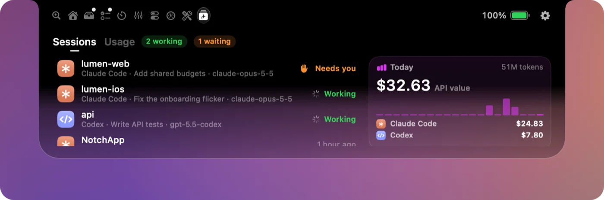

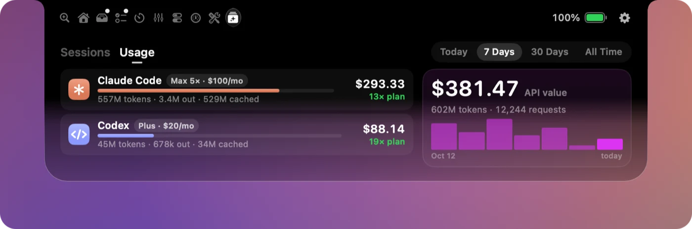

Claude Code, Codex, OpenCode and ZCode sessions (working, waiting for you, idle); click one to jump to its terminal.
**Usage** shows tokens, the API-equivalent dollar value and how many times over your plan paid off, by day, week,
month or all time. Read-only, from each tool's local files.

With **live activity** on (Settings › Agents), read-only Claude Code hooks tell the notch what each session is doing
right now and how many subagents it has out, and a Banner says what it edited and how long it took when it's done.
The hooks never answer anything for you.

### The `notch` command and MCP

```bash
notch run cargo build                 # a ring beside the notch, then a Banner with the exit code (click: back to the terminal)
notch banner "Deploy done" "api is live" --success
notch progress 0.4 "Uploading" --label 2/5   # notch progress --done to clear it
notch shelf dist/app.dmg
notch ask "Rebase or merge?" Rebase Merge     # prints the choice
claude mcp add --scope user notchapp -- /Applications/NotchApp.app/Contents/MacOS/notch mcp
```

`notch mcp` lets coding agents report progress, show Banners, put files on the Shelf and ask quick multiple-choice
questions. Permission questions are refused; those stay in the terminal. Settings › Agents installs the command on your PATH.

## And also

| | |
|---|---|
| **Music** | Album art, scrubbable progress, a visualizer tinted to the artwork, output switcher. Music, Spotify, Podcasts and browsers |
| **Calendar** | Today's events and a heads-up before each meeting, with Join for Zoom, Meet, Teams and Webex |
| **Morning brief** | A short AI-written brief on the first unlock of the day, and "due soon" nudges |
| **Keep Awake** | Timed sessions, a battery floor, and automatic while coding agents work |
| **Camera mirror** | A mirrored preview from the notch header; the camera only runs while it's open |
| **Mouse & trackpad** | Reverse mouse-wheel scrolling (trackpad stays natural) and three-finger middle click |
| **Shortcuts** | ⌃⌥ + a letter opens any tab from anywhere; ⌃⌥Space toggles the notch |
| **Settings** | Per-feature toggles, accent colour, animation style, launch at login; a fake notch on displays without one |

<sub>Screenshots use made-up data from a demo build.</sub>

## Build & run

No Xcode needed — Command Line Tools are enough.

```bash
./build.sh            # builds build/NotchApp.app
./build.sh install    # also copies to /Applications and launches it
```

Releases are published on GitHub and the app updates itself from them.

### Local AI (Ollama)

Search, briefs and nudges use a local model through [Ollama](https://ollama.com). Without one, search still
works: files by name, web results as links, weather, and the instant answers.

```bash
brew install ollama
brew services start ollama
ollama pull qwen3.5:9b   # or gemma4:e4b, llama3.2:3b, or pick one in Settings → Assistant
```

Web search sends only the query to Brave Search (falling back to DuckDuckGo, then Bing) and fetches the
top pages. Weather comes from Open-Meteo. Video downloads use Homebrew's `yt-dlp` and `ffmpeg` if installed.

### Permissions

- **Accessibility**: the volume/brightness HUD, Ask about this, and keyboard shortcuts.
- **System Audio Recording**: the per-app Mixer (macOS 14.2+).
- **Calendar, Camera**: only if you use those features.

## How "Now Playing" works on macOS 15.4+

Apple restricted the private MediaRemote framework to entitled processes. `MediaAdapter/` holds a
tiny Objective-C dylib that `/usr/bin/perl` (still entitled) loads and uses to stream now-playing JSON
back to the app. This is the same approach Boring Notch uses.

## Layout

```
Sources/NotchApp/
  App/        entry point, app delegate, debug hooks
  Notch/      panel window, geometry, mouse tracking, per-screen view model
  Views/      SwiftUI views (collapsed activities, open panel, music, calendar, shelf)
  Services/   media, audio devices, HUD/media keys, battery, shelf, screenshots, calendar, system sensors
  Settings/   preferences model + settings window
Sources/notch/  the `notch` command (scripts, Claude Code hooks, MCP server), shipped in Contents/MacOS
MediaAdapter/ MediaRemote bridge (ObjC + perl loader)
scripts/      icon generator, debug command sender
docs/         README screenshots
```

## Debugging

```bash
defaults write com.notchapp.NotchApp debugHooks -bool YES   # then relaunch
swiftc scripts/debug.swift -o build/notchdebug
build/notchdebug pin; build/notchdebug open home; build/notchdebug snapshot /tmp/notch.png
# Log: ~/Library/Logs/NotchApp/debug.log (commands need the token NotchApp writes at launch)
build/notchdebug volume 0.5 | brightness 0.3 | charging | meeting | screenshot | fakeplay | close
build/notchdebug expand cpu | timer start|pause|skip|reset | pane notes|downloads | peek timer|download
```

## Notes

- Without a signing identity, local builds are ad-hoc signed. Every rebuild then changes the signature, so macOS may ask for Accessibility
  access again (remove the old NotchApp entry in System Settings → Privacy & Security → Accessibility,
  then re-add it).
- Builds are Apple-silicon only; universal builds need full Xcode.
- Inspired by [Boring Notch](https://github.com/TheBoredTeam/boring.notch).
