<div align="center">

# NotchApp

**The MacBook notch, turned into a live, interactive hub.**

A black shape that melts into the notch, springs open into Liquid Glass on hover,
and keeps search, music, files, your calendar, stats and your coding agents one flick of the pointer away.

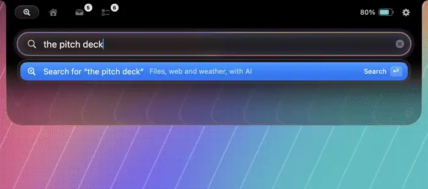

Native Swift · SwiftUI + AppKit + Core Animation · macOS 14.2+ (Liquid Glass on macOS 26) · Apple silicon · no Xcode needed

[Watch the full demo](docs/notchapp-demo.mp4) · [Releases](https://github.com/danielrabnovich/NotchApp/releases)

</div>

---

## Search

The notch's best trick: **one bar that works out what you mean.** Describe a file the way you remember it,
ask a question, do a sum, or tell it to do something. Hover and start typing.

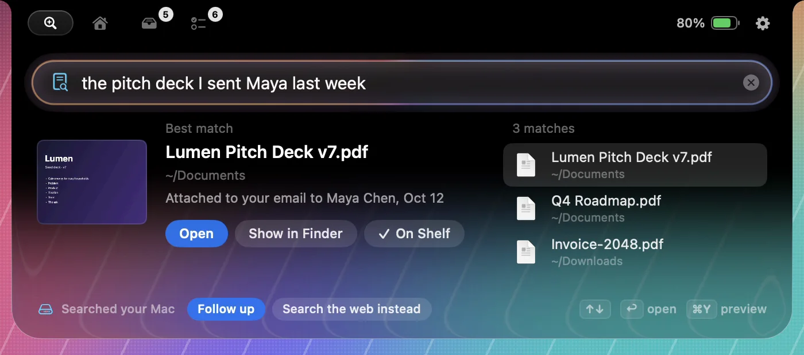

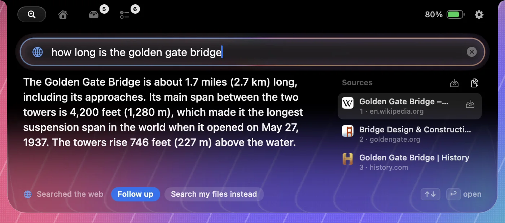

- **Files** from vague descriptions: who you sent it to, roughly when, what kind of file, even what a picture shows or the text in a screenshot. Preview it (⌘Y), open it, or put it on the Shelf.
- **Web answers** written from the top pages, with numbered sources you can open or save. Follow up, or carry it on as a **chat** (⌘↩, or ⌃⌥N for a new one) in its own window.
- **Instant answers as you type**: maths, percentages, units, currencies, time zones and day counts. No model needed.
- **Apps and files as you type**, fuzzy-matched and learning what you open. **⌘K** on a result lists everything you can do with it: open with, show in Finder, copy the path, Get Info, quit, force quit or uninstall an app, AirDrop a file.
- **Emoji and symbols**: type `:` (or press ⌃⌥E), then a word. Skin tones, most-used first, and the symbols people look for that aren't emoji (⌘ ⌥ ⇧ ↩ ✓ ° €).
- **Actions in plain words**: `timer 10m`, `remind me to call mom tomorrow at 5`, `add lunch with Sam friday 1pm`, `move my 3pm to 4`, `dark mode on`, `volume 40`, `left half`. One safe action just happens, with Undo; anything bigger is shown for you to confirm. Type `/` for every command.
- **Your calendar, notes and tasks**: "am I free friday at 3", "when is my dentist appointment".
- **Weather** for anywhere, with the week ahead.
- **Do it in this app**: "export as pdf", "new private window", "bold". NotchApp finds it in the app's own menus and runs it.
- **Your screen**: ask "what's this error" or "summarize this page" about what's behind the notch. ⌃⌥S asks about the window in front (its real text, through Accessibility), ⌃⌥Z about an area you pick. Explain, Summarize, Translate, Copy text, with follow-ups.
- **Recall** (off until you turn it on): an on-device memory of what was on screen, so "what was that error in Terminal yesterday" or "the pricing page I looked at Tuesday" finds it. It never captures password managers, private windows or a shared screen, and you can pause it or erase it from the search bar.
- **AI Commands**: saved prompts like Fix grammar or Make it shorter, run on selected text from the bar or their own shortcut.

<p>
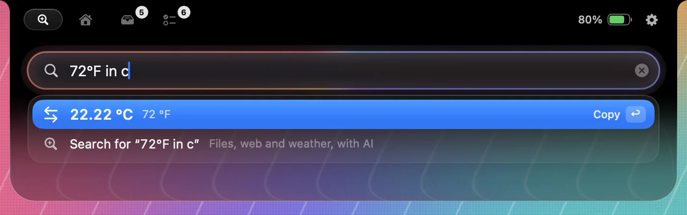
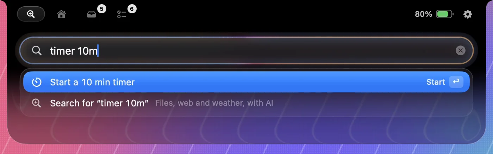
</p>
<p>
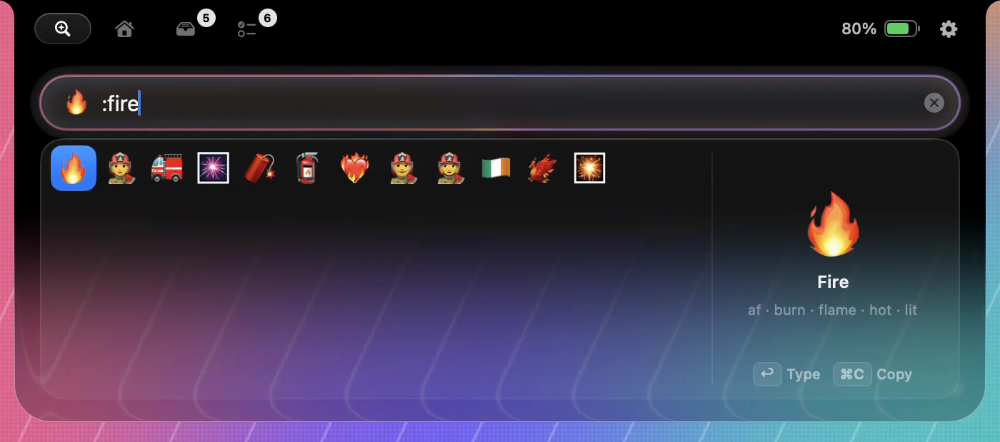
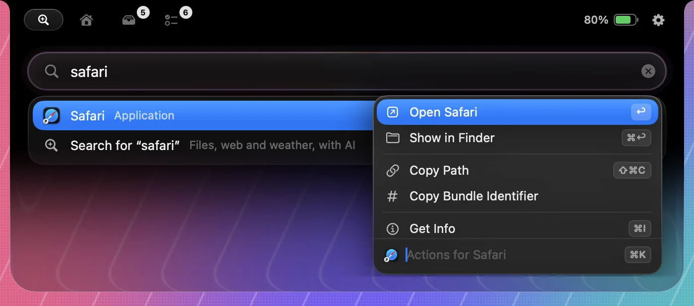
</p>

### Models

Search works without a model: files by name, web results as links, weather, commands and the instant answers.
A model adds written answers, smarter file finding and actions. Pick one in Settings → Search:

- **On this Mac**: Apple Intelligence on macOS 26 (nothing to install), or any model through [Ollama](https://ollama.com). Nothing leaves the Mac.
- **Your Claude or ChatGPT plan**: NotchApp runs the `claude` or `codex` command you already have, signed in with your plan. No key to paste, and NotchApp never sees your login.
- **Your own key**: Anthropic, OpenAI, OpenRouter, Gemini, Groq, DeepSeek, Z.ai, or anything Anthropic- or OpenAI-compatible.

## Liquid Glass

On macOS 26 the open notch is **Dynamic Glass**: black where it meets the notch, melting into glass below,
moving with the notch as it springs open. Choose how much is glass (**Tinted, Balanced, Airy or Clear**) or keep it
black throughout. Pages slide on Core Animation with **Smooth, Snappy or Bouncy** motion, and the search bar
wears Apple Intelligence's glow, a white shimmer, or nothing.

## Home

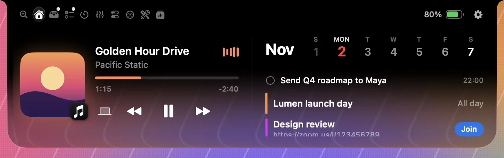

Cards in a row, laid out for you: music with a visualizer tinted to the artwork, today and the week, weather by
the hour, and your pick of Stats, Batteries, World Clock, Agents, Shelf, Timer, Clipboard, Unread, Scratchpad,
Network and Countdown. **Right-click Home to edit it in place**: drag cards around, resize them, add and remove.
Birthdays, a call in progress and "time to leave" fit in without pushing anything out.

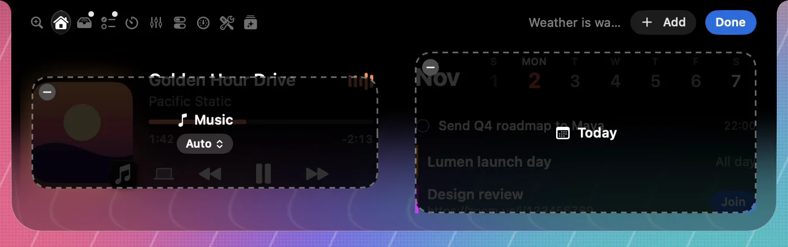

## Glances

Small live indicators beside the closed notch, up to five a side, in any mix: music, timer, next event,
weather, battery, CPU/GPU/memory rings, temperature, power, network, Focus, tasks, agents, world clock,
golden hour, unread counts, a countdown, downloads in progress, VPN and more, plus one-click actions
(screenshot, copy text, colour picker, lock, dark mode, mic) and your own Shortcuts. Every Glance has a
**compact form**, and a side that runs out of room compacts its outer ones by itself.

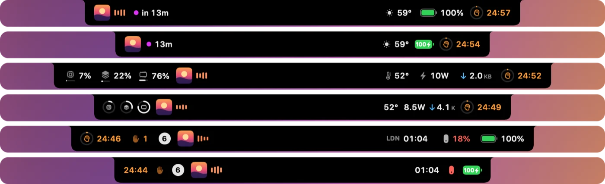

**Click** a Glance to act on it (play/pause, pause the timer, join the meeting, jump to an agent), **rest the pointer** on it
for details, **right-click** for options.

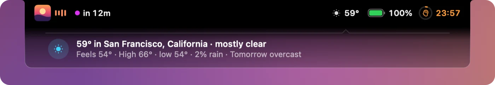

## Alerts, in three tiers

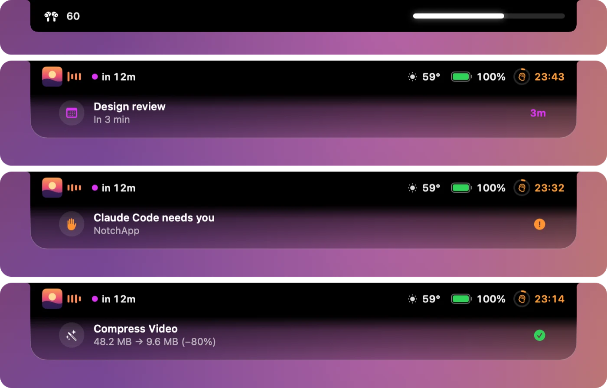

- **Flashes** sit in the wings: volume and brightness (instead of the system overlay), charging.
- **Banners** drop down under the notch without moving your Glances. They queue, pause under the pointer and wait while a full-screen app is in front.
- **Prompts** carry buttons (Join Zoom, Open, Snooze, Reply) and fold into a tab you can click later.

Meetings, coding agents that need you, notifications you can reply to, finished downloads and conversions,
a dev server coming up, going offline, a VPN dropping, AirPods running low, a doorbell, a knock or an alarm while
you're wearing headphones: each lands in the tier it deserves.

<br clear="right">

## Meetings

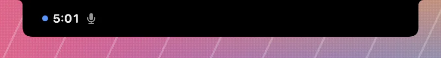

A heads-up before each meeting with **Join** for Zoom, Meet, Teams and Webex, then a call timer and mute
button beside the notch. Meeting mode can **record the call** (it asks first) and transcribe it on this Mac:
notes and action items afterwards, the call to play back from any line, and the other side's voices told
apart and named when the call makes it clear. **Live captions** for anything playing, and a **teleprompter**
that rolls under the camera.

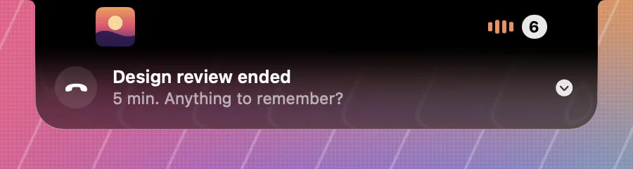

## Shelf

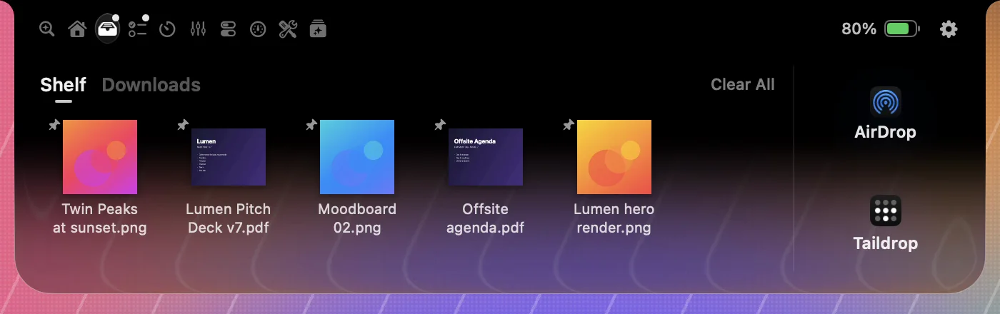

<p>
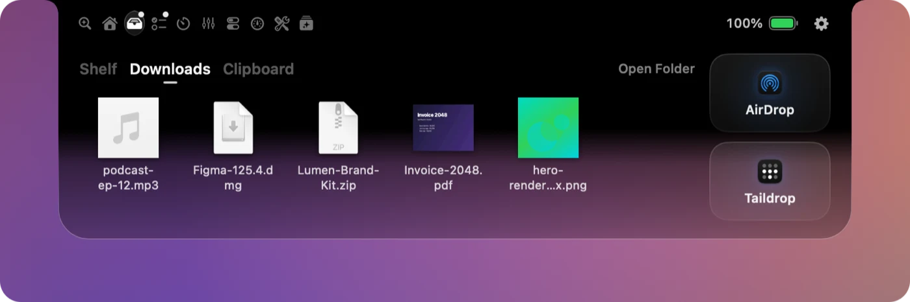
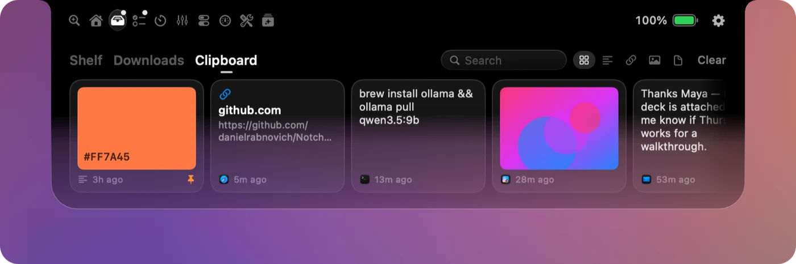
</p>

Drag files onto the notch and back out, or **shake a file mid-drag** and a little tray appears at the pointer.
Drag several out as one zip; hold ⌘ to move instead of copy. **AirDrop** and **Taildrop** (your Tailscale
devices) drop zones, screenshots caught automatically, **recent Downloads**, and a **Clipboard history** that
shows colours as swatches, cleans tracking from links and skips password managers. Drop files on Convert for
MP4, GIF, WebM (AV1), compressed video, MP3/M4A or JPEG/PNG; video runs on the media engine.

## Tasks, Notes & Timer

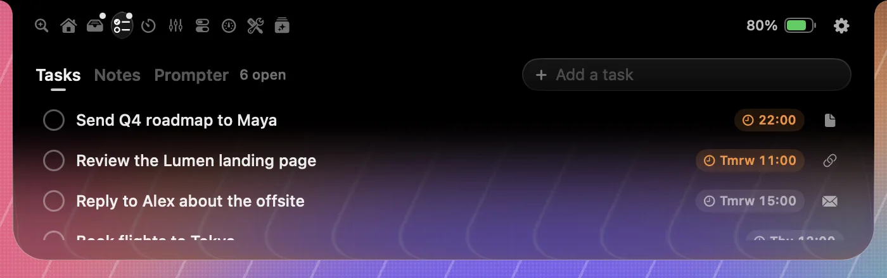

Drag text, links, emails or files onto the notch to make a task; type due dates the way you'd say them
("by Friday 3pm"). A morning brief on the first unlock of the day and "due soon" nudges. **Ramble** (⌃⌥J):
talk or type everything on your mind and get tasks, events and a note back, dictated on this Mac.
A scratchpad that saves itself, and a countdown, Pomodoro and stopwatch that keep ticking beside the notch.

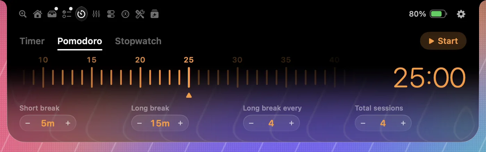

## Controls & Mixer

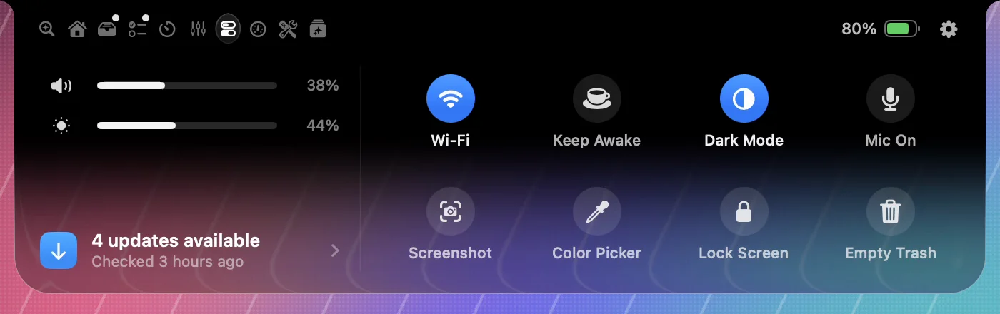

Pick and order up to 12 tiles: Wi-Fi, Keep Awake (with the display off or the lid closed), Dark Mode, mic mute,
Copy Text (OCR any region), Ports, Speed Test, Cleaner, Night Shift, Flush DNS, Scan QR, Live Captions,
Clean Keyboard, Save Video and more. Homebrew and Sparkle app updates sit under the sliders.

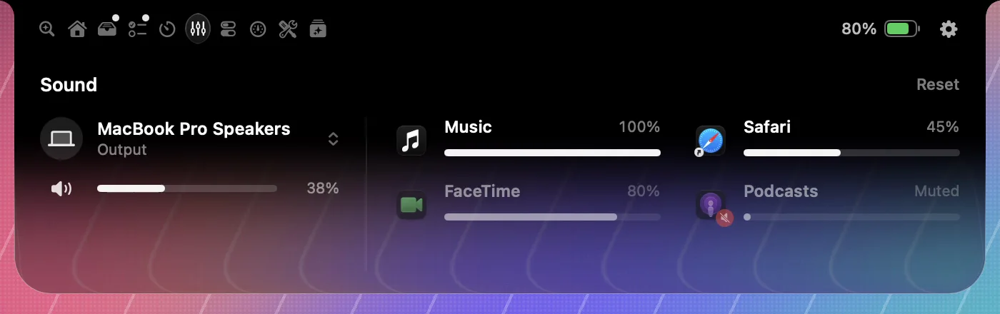

The **Mixer** sets each app's volume, or mutes it, through a Core Audio process tap. Apps left at 100% are untouched.

## Stats & Tools

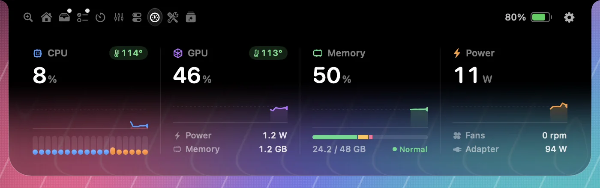

CPU (per-core bars, user/system graph), GPU, memory (app/wired/compressed, pressure) and where the power goes,
with temperatures, fan speed and battery time, and a heads-up when the Mac runs hot. Read straight from the
SMC, IOReport and IOKit; no helper, no root.

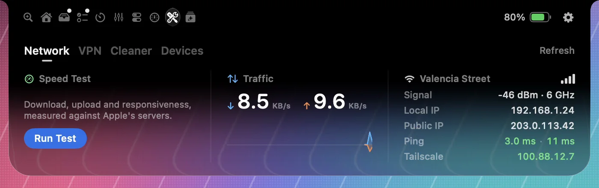

<p>
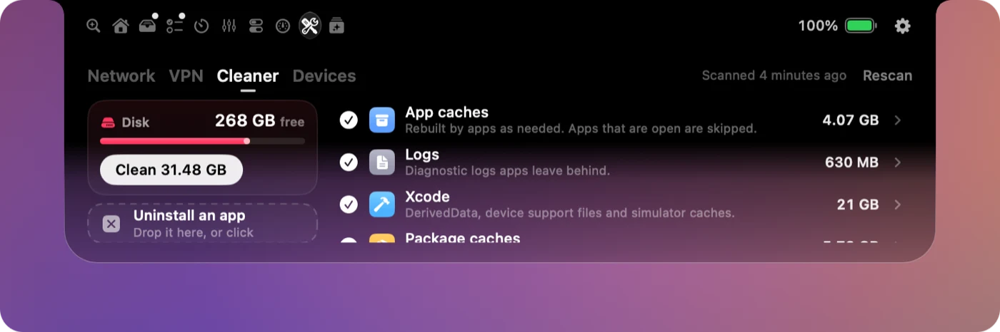
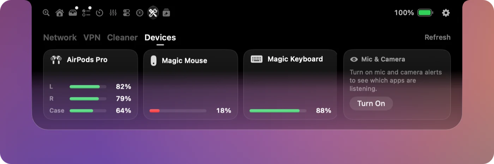
</p>

- **Network**: speed test with a live readout beside the notch, traffic, Wi-Fi signal and band, IPs, ping.
- **VPN**: every VPN on the Mac (Proton, Tailscale, NordVPN, WireGuard, PIA, Mullvad…) with where your traffic exits.
- **Cleaner**: caches, logs, Xcode and package-manager leftovers, old installers and big forgotten files, Time Machine snapshots, and an app uninstaller that finds leftovers in `~/Library`.
- **Devices**: AirPods, mouse and keyboard batteries with low-battery alerts, and which apps are using the mic or camera.

## Agents

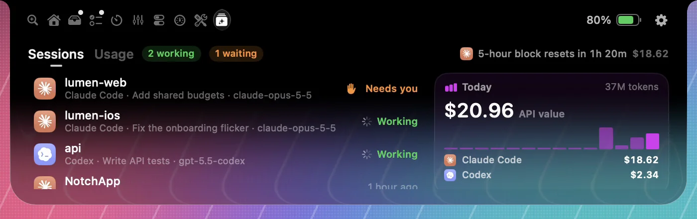

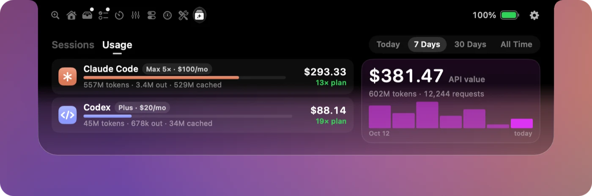

Claude Code, Codex, OpenCode and ZCode sessions (working, waiting for you, idle); click one to jump to its
terminal, or reply from the notch. **Usage** shows tokens, the API-equivalent dollar value and how many times
over your plan paid off, by day, week, month or all time, with Claude Code's 5-hour block in the header.
Read-only, from each tool's local files. Keep Awake turns on while agents work.

With **live activity** on (Settings › Agents), read-only Claude Code hooks tell the notch what each session is doing
right now and how many subagents it has out, and a Banner says what it edited and how long it took when it's done.
The hooks never answer anything for you.

### The `notch` command and MCP

```bash
notch run cargo build                 # a ring beside the notch, then a Banner with the exit code (click: back to the terminal)
notch banner "Deploy done" "api is live" --success
notch progress 0.4 "Uploading" --label 2/5   # notch progress --done to clear it
notch shelf dist/app.dmg
notch ask "Rebase or merge?" Rebase Merge     # prints the choice
claude mcp add --scope user notchapp -- /Applications/NotchApp.app/Contents/MacOS/notch mcp
```

`notch mcp` lets coding agents report progress, show Banners, put files on the Shelf and ask quick multiple-choice
questions. Permission questions are refused; those stay in the terminal. Settings › Agents installs the command on your PATH.

## Keyboard

Every tab and most actions have a shortcut, ⌃⌥ plus a key by default, all rebindable in Settings → Keyboard Shortcuts.
Turn **Caps Lock into a Hyper key** (⌃⌥⇧⌘) if you'd rather not hold four keys.

| | |
|---|---|
| ⌃⌥Space | Open or close the notch |
| ⌃⌥G · M · F · T · R · V · C · I · O · A | Search, Home, Shelf, Tasks, Timer, Mixer, Controls, Stats, Tools, Agents |
| ⌃⌥S · ⌃⌥Z | Ask about the window in front · about an area you pick |
| ⌃⌥N · ⌃⌥E · ⌃⌥J | New chat · emoji & symbols · Ramble |
| ⌃⌥B · ⌃⌥X | Clipboard history · copy text from the screen |
| ⌃⌥ ← → ↑ ↓ ↩ | Window halves and maximize (thirds and quarters can be turned on): Rectangle, built in |

## And also

| | |
|---|---|
| **Music** | Album art, scrubbable progress, a visualizer tinted to the artwork, output switcher. Music, Spotify, Podcasts and browsers |
| **Shortcuts & Siri** | Timers, tasks, Banners, the Shelf, captions and Glances as Shortcuts actions; your own shortcuts run from the search bar and as Glances |
| **Notifications** | Mirrored in the notch, with Reply |
| **Camera mirror** | A mirrored preview from the notch header; the camera only runs while it's open |
| **Mouse & trackpad** | Reverse mouse-wheel scrolling (trackpad stays natural) and three-finger middle click |
| **Help** | Ask Search about NotchApp itself ("where's the setting for…") and it answers with links into Settings |
| **Settings** | Per-feature add-ons, accent colour, glass and motion, launch at login, a welcome window, crash reports you can read; a fake notch on displays without one |

<sub>Screenshots and the demo use made-up data from a demo build.</sub>

## Build & run

No Xcode needed — Command Line Tools are enough.

```bash
./build.sh            # builds build/NotchApp.app
./build.sh install    # also copies to /Applications and launches it
```

Releases are published on GitHub and the app updates itself from them.

### Local AI (Ollama)

```bash
brew install ollama
brew services start ollama
ollama pull qwen3.5:9b   # or gemma4:e4b, llama3.2:3b, or pick one in Settings → Search
```

Web search sends only the query to Brave Search (falling back to DuckDuckGo, then Bing) and fetches the
top pages. Weather comes from Open-Meteo. Video downloads use Homebrew's `yt-dlp` and `ffmpeg` if installed.

### Permissions

Each is asked for the first time a feature needs it; Settings → Permissions lists them all.

- **Accessibility**: the volume/brightness HUD, keyboard shortcuts, menus and in-app actions, Ask about this.
- **Screen Recording**: questions about your screen, and Recall.
- **System Audio Recording**: the per-app Mixer (macOS 14.2+).
- **Microphone**: captions, Ramble and meeting transcripts. **Calendars, Contacts, Location, Camera**: only if you use those features.

### Privacy

Everything runs on your Mac unless you choose a cloud model. Web searches send only the search words. Screen
questions capture the screen in memory and never save it. Clipboard history, transcripts and Recall are kept on
this Mac only.

## How "Now Playing" works on macOS 15.4+

Apple restricted the private MediaRemote framework to entitled processes. `MediaAdapter/` holds a
tiny Objective-C dylib that `/usr/bin/perl` (still entitled) loads and uses to stream now-playing JSON
back to the app. This is the same approach Boring Notch uses.

## Layout

```
Sources/NotchApp/
  App/        entry point, app delegate, debug hooks
  Notch/      panel window, geometry, mouse tracking, per-screen view model
  Views/      SwiftUI views (Search/, Home, Shelf, Tasks, Glances…)
  Services/   media, audio, calendar, meetings, sensors, agents, AI/ (search, models, Recall)
  Settings/   preferences model, settings window and Panes/
Sources/NotchKit/  fuzzy matching, emoji catalogue, link cleaning (tested)
Sources/notch/     the `notch` command (scripts, Claude Code hooks, MCP server), shipped in Contents/MacOS
Help/          the guide Search answers questions about NotchApp from
MediaAdapter/  MediaRemote bridge (ObjC + perl loader)
scripts/       icon and emoji generators, help builder, debug command sender
docs/          README screenshots and demo
```

## Debugging

```bash
defaults write com.notchapp.NotchApp debugHooks -bool YES   # then relaunch
swiftc scripts/debug.swift -o build/notchdebug
build/notchdebug pin; build/notchdebug open home; build/notchdebug snapshot /tmp/notch.png
# Log: ~/Library/Logs/NotchApp/debug.log (commands need the token NotchApp writes at launch)
build/notchdebug volume 0.5 | brightness 0.3 | charging | meeting | screenshot | fakeplay | close
build/notchdebug expand cpu | timer start|pause|skip|reset | pane notes|downloads | peek timer|download
```

## Notes

- Without a signing identity, local builds are ad-hoc signed. Every rebuild then changes the signature, so macOS may ask for Accessibility
  access again (remove the old NotchApp entry in System Settings → Privacy & Security → Accessibility,
  then re-add it).
- Builds are Apple-silicon only; universal builds need full Xcode.
- Inspired by [Boring Notch](https://github.com/TheBoredTeam/boring.notch).
